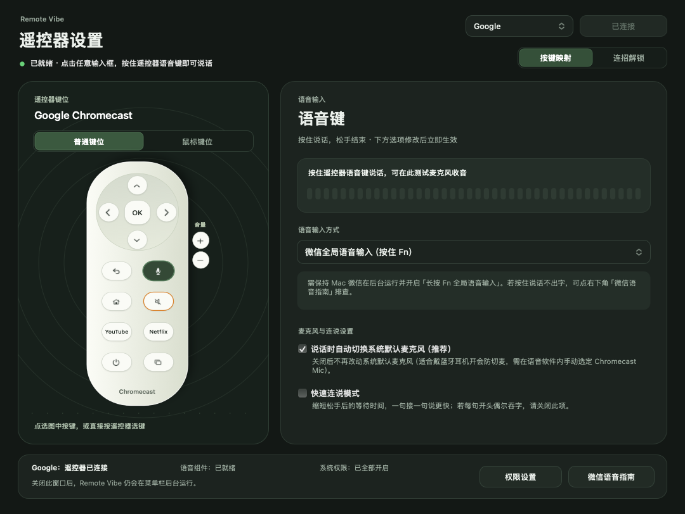
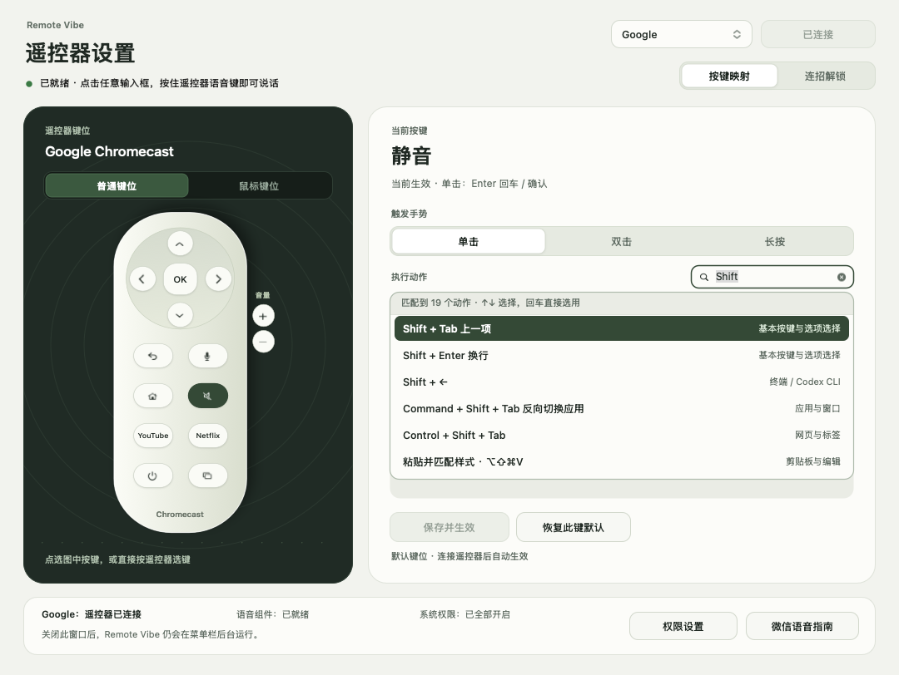
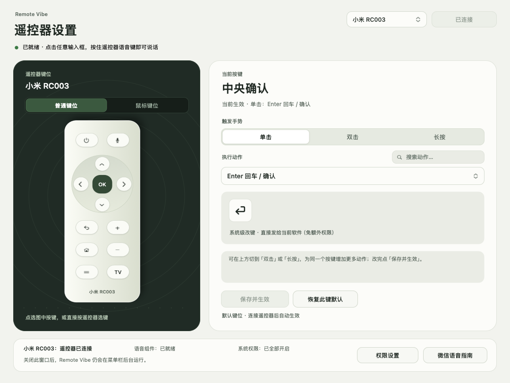
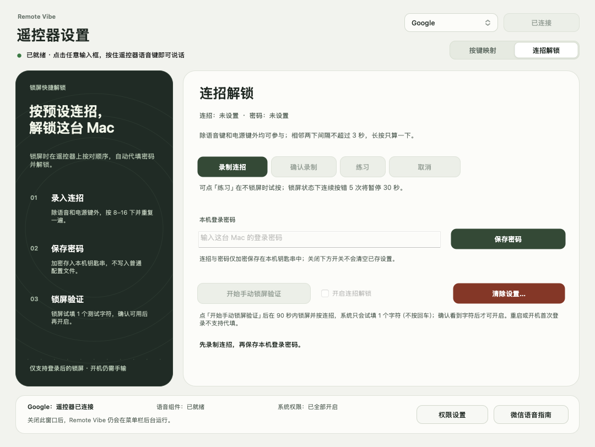

# Remote Vibe

用几十块钱的 **Google Chromecast** 或 **小米蓝牙遥控器 2 Pro（RC003）**，直接在 Mac 上按住说话打字、按快捷键、当鼠标用。

平时靠在椅背上刷网页、看文档或者用 Codex CLI，不想一直把手架在键盘上，手里握个小遥控器就够了。纯原生 Swift 写的菜单栏小工具，不带第三方运行时，随系统自动切换深浅色。一次连一只遥控器，两款型号的键位配置分开保存。

## 宣传片

https://github.com/user-attachments/assets/ec4ab9ff-594f-49b3-9f1f-0f4ecc002a6f

40 秒 60fps 演示，带 BGM 和交互音效，建议开声音看。

## 能做什么

- **按住说话打字**：把遥控器自带的麦克风接进 Mac。在「语音工作台」里可以实时看 24 格收音音量条（在设置窗口里试麦不会误触打字），支持 **微信全局语音（按住 Fn）**、**豆包 / Superwhisper（按住右 Option）**、**系统听写（点按 ⌥Space）**、**仅当麦克风用**，也可以自己录触发快捷键。还带防蓝牙耳机开会切麦和快速连说开关。
- **每个键都能改**：Google 14 键（最多 42 个动作）、小米 RC003 12 键（最多 36 个动作），每个普通键都能单独设 **单击、双击、长按**。打开设置窗口时，直接按手里的遥控器，界面会自动高亮跳到那个键。
- **113 个现成动作，搜一下就有**：覆盖常用编辑、切窗口切屏、浏览器标签、音量亮度、截屏和 **Codex CLI / 终端** 常用操作。搜索框支持中英文，输入 `Shift`、`Cmd`、`Opt` 就能直接搜出带 `⇧`、`⌘`、`⌥` 的快捷键；没有现成的，点一下录制框直接按键盘录进去就行，也支持发常用文本、打开应用或网页。
- **一键切鼠标**：给任意手势设成「切换鼠标模式」就能遥控光标——方向键按住加速移动、松开即停，OK 左键、返回右键，再按一次切回普通按键。
- **连招解锁 Mac**：录一段 8–16 下的按键顺序，锁屏时按对就自动填密码解锁。连招和密码只加密存在本机钥匙串里，不进配置文件，必须先手动锁屏试填成功才能开启。
- **不打扰、省电**：手动扫描配对，连上就停扫；关掉设置窗口继续在菜单栏后台运行，图标会跟着普通 / 收音 / 鼠标三种状态变。

## 界面

**v0.6.1** 实际界面：

| 语音工作台（深色模式） | 实时搜索动作（Google Chromecast） |
| --- | --- |
|  |  |

| 小米 RC003 按键设置 | 锁屏连招解锁 |
| --- | --- |
|  |  |

## 怎么开始用

需要 **Apple Silicon 或 Intel Mac、macOS 15 或更新版本**。

1. 去 [Releases](https://github.com/jmeviler/remote-vibe/releases) 按芯片下完整安装包：M 系列选 `Mac-AppleSilicon.zip`，Intel 选 `Mac-Intel.zip`。解压后按里面的说明装好 App 和语音组件。
2. 在系统蓝牙设置里连上遥控器，打开 Remote Vibe 选对应型号，按提示给辅助功能、输入监控和蓝牙权限。
3. 点遥控器图上的麦克风键选好你的语音工具（默认配微信「长按 Fn 全局语音输入」），点进任意输入框，按住语音键说话，松手出字。

> **Intel 说明**：Intel 版已经在云端独立编译、测试并打包，不过真机蓝牙和微信出字还没实测过，目前算试用包。

## 几个小提示

- **改键和备份**：改完键位记得点 **保存并生效**（有没保存的修改关窗口前会提醒）。菜单栏的 **键位配置** 支持导出、导入或恢复上次备份，配置里含常用文本、应用路径和网址，**不含**连招解锁密码。
- **只更新 App**：已经装过对应芯片的语音组件，以后在菜单栏点检查更新，直接下 `App-AppleSilicon.zip` 或 `App-Intel.zip` 覆盖就行，不用重装驱动，也不会重启系统音频服务。
- **Google 遥控器小加分**：可以把普通键设成「遥控器麦克风」；如果只是映射键盘 `Fn` 键，不会启动遥控器收音。
- **关于安全提示**：软件还没做 Apple 公证，第一次安装和授权需要自己手动放行，具体步骤看 [安装与使用说明](Installer/开始使用.txt)。
- **关于切麦**：开着自动切麦时，说话那几秒会临时把系统默认输入切到虚拟麦克风，说完自动切回；戴蓝牙耳机开会或录屏，建议在语音工作台关掉自动切麦，详见 [音频说明](Docs/AUDIO-BEHAVIOR.md)。

## 自己编译

提 PR 后 GitHub Actions 会在 Apple Silicon 和 Intel 云端 Mac 上各自编译、跑测试并打好包，直接下 `Remote-Vibe-Release` 产物就能拿到两套完整包、两套更新包和校验文件。只用按键映射不需要装驱动。

- [安装、按键设置与常见问题](Installer/开始使用.txt)
- [开发、构建与验证](Docs/DEVELOPMENT.md)
- [发布与更新](Docs/RELEASING.md)
- [常驻性能记录](Docs/PERFORMANCE.md)

## 许可证

采用 [GPL v3](LICENSE)。虚拟麦克风基于 [BlackHole](https://github.com/ExistentialAudio/BlackHole)，修改记录见 [Driver/SOURCE.md](Driver/SOURCE.md)。
