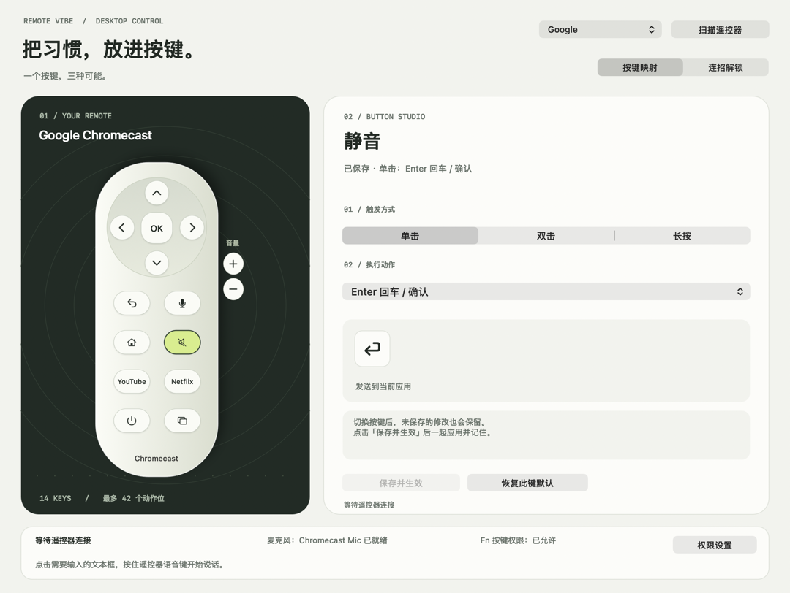
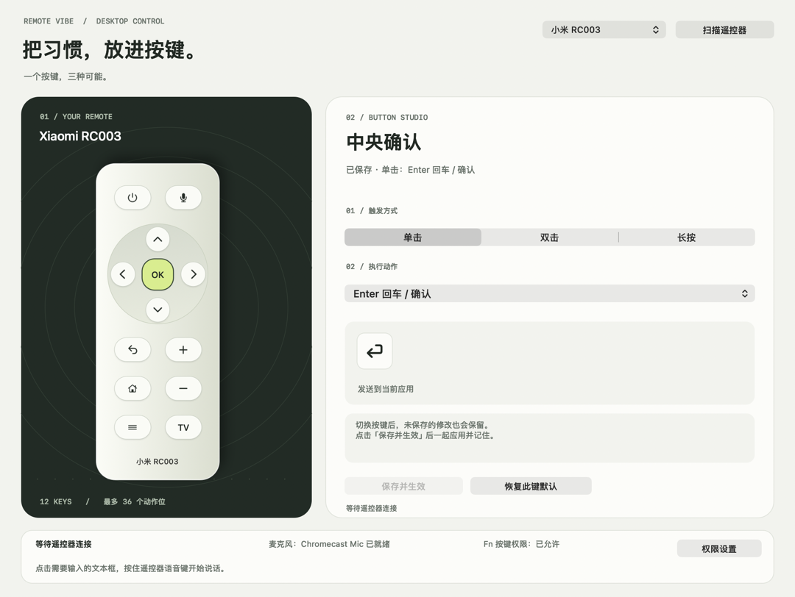

# Remote Vibe

用 Google Chromecast 或小米 RC003 遥控器，在 Mac 上说话输入、操作快捷键。

原生 Swift / AppKit 菜单栏应用，无第三方运行时。一次使用一只遥控器，两种型号的配置独立保存。

- **按住说话**：遥控器麦克风收音，通过微信的全局语音输入转成文字。
- **自定义按键**：单击、双击、长按可绑定快捷键、常用文本、应用、网页和窗口操作。
- **按需工作**：手动扫描新设备，连接后停止扫描；关闭设置窗口后继续运行。

## 界面

| Google Chromecast | 小米 RC003 |
| --- | --- |
|  |  |

应用界面截图，使用隔离的示例配置。

## 开始使用

需要 **Apple Silicon Mac、macOS 15+**。语音输入还需要微信支持“长按 Fn 全局语音输入”。

1. 解压试用包，按其中的说明安装 Remote Vibe 和语音组件。
2. 在系统蓝牙设置中配对遥控器，打开 App 选择型号，并按提示开启权限。
3. 启用微信全局语音输入，点击目标文本框，按住遥控器语音键说话，松开出字。

点击配置图上的普通按键即可改绑，完成后点击 **保存并生效**。Google 还支持将普通键设为“遥控器语音”；单独映射 Fn 不会开启遥控器麦克风。

试用包尚未经过 Apple 公证，首次安装和授权需要本人操作，详见 [安装与使用说明](Installer/开始使用.txt)。

语音期间会临时切换系统默认麦克风，结束后尝试恢复。会议或录音软件请指定实体麦克风，详见 [音频影响](Docs/AUDIO-BEHAVIOR.md)。

## 从源码构建

安装 Xcode Command Line Tools 后，在仓库根目录运行：

```sh
zsh Scripts/build-app.sh
open "build/Remote Vibe.app"
```

普通按键映射不需要驱动；语音组件的构建、安装与打包方法见 [开发说明](Docs/DEVELOPMENT.md)。

- [安装、按键设置与常见问题](Installer/开始使用.txt)
- [开发、构建与验证](Docs/DEVELOPMENT.md)
- [常驻性能记录](Docs/PERFORMANCE.md)

## 许可证

当前采用 [GPL v3](LICENSE)。虚拟麦克风基于 [BlackHole](https://github.com/ExistentialAudio/BlackHole)，源码及修改说明见 [Driver/SOURCE.md](Driver/SOURCE.md)。
